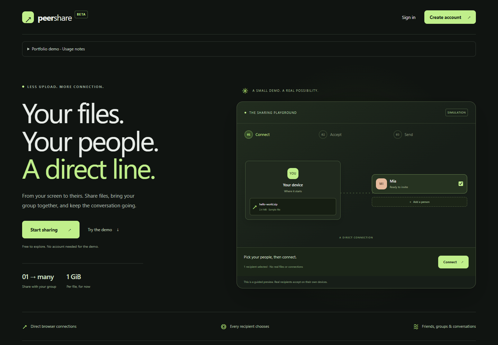
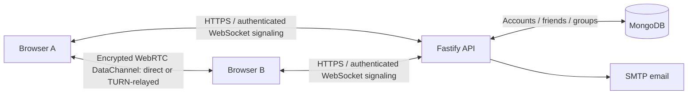

# Peer Share

A full-stack file-sharing and chat application built as a learning and portfolio project. Verified users pair specific browser sessions, accept transfers, and exchange files over encrypted WebRTC DataChannels. Friends and small groups make repeat sharing easier.

[Open the live app](https://peer-share-jacob.onrender.com/) · [Source](https://github.com/JacobEmanuelsson/peer-share)



The landing-page playground is a simulation. Real transfers require two different verified accounts in the workspace.

## Features

- Email verification, sign-in/out, password reset, account settings and deletion.
- Invitation-based pairing with explicit acceptance on the receiving browser session.
- Bidirectional file transfers, receiver approval, progress, cancellation and manual retry.
- Files up to **1 GiB (1,073,741,824 bytes)**, streamed in chunks to browser disk storage.
- Incremental SHA-256 verification before a completed download is offered.
- Friends, blocking, and groups of up to six members, including the owner.
- Text chat and file activity with sender/timestamps; history stored on the current browser only.
- Direct connections where possible, TURN fallback and visible connection-route status.

## Architecture



The server authenticates users, manages social data and pairing, and forwards WebRTC connection descriptions and ICE candidates. File contents and chat messages travel over WebRTC, rather than through the application API or MongoDB. TURN can relay the encrypted traffic when a direct connection fails. Group sharing creates separate peer connections and transfers for recipients, so bandwidth use grows with group size.

| Layer | Technologies |
| --- | --- |
| Frontend | React, TypeScript, Vite, Tailwind CSS, React Router, TanStack Query |
| Backend | Node.js, Fastify, TypeScript, Zod, Better Auth |
| Database | MongoDB with the official driver |
| Transfer/storage | WebRTC, WebSockets for signaling, OPFS, IndexedDB, hash-wasm |
| Deployment | Render, MongoDB Atlas, SMTP email, optional TURN provider/coturn |

`client/src/features` contains the UI and feature APIs. `client/src/webrtc` owns connection and transfer behavior outside React. Backend modules live under `server/src/modules`, with HTTP/WebSocket boundaries separated from business rules and persistence.

## Demo limits and privacy

- Free hosting may need about a minute to wake after inactivity.
- The hosted demo shares a **500 MB/month TURN allowance**. Relay traffic counts against that allowance; it cannot accommodate a 1 GiB relay test. The 1 GiB result below used a **direct** connection. Provider limits can make relay fallback unavailable.
- Receiving files needs HTTPS (or localhost), supported browser storage APIs and enough free storage. A quota estimate is advisory; private browsing and mobile devices can impose lower limits. Downloading can require additional disk space.
- Keep both pages open. Refreshing, closing or losing a connection interrupts transfers; automatic resume is not implemented. Retain the original file.
- Chat text and file metadata persist in IndexedDB on this browser. They do not sync to other devices and clearing site data removes them. Download links are not restored after refresh.
- WebRTC provides transport encryption. This project does not claim an independent security audit or peer identity verification independent of the signaling server. Account/social data is stored server-side; the app is not anonymous.
- Browser support varies. Desktop Chrome and Edge have full large-file test evidence. Do not assume the same limit or behavior on every browser/device.

## Run locally

Use Node.js **22.12 or newer** and Docker Desktop with its engine running.

```sh
npm ci
cp server/.env.example server/.env
```

On PowerShell, use `Copy-Item server/.env.example server/.env` instead of `cp` if preferred. Set a private random `BETTER_AUTH_SECRET` of at least 32 characters. Keep environment files out of Git. The example uses local MongoDB and Mailpit; no paid email service is needed for local development.

Start these from the repository root:

```sh
# Terminal 1: database and local email inbox
 docker compose up -d

# Terminal 2: API / WebSocket server (localhost:3000)
 npm run dev:server

# Terminal 3: frontend (localhost:5173)
 npm run dev:client
```

Open http://localhost:5173 and sign up. Read verification/reset messages at http://localhost:8025. For pairing, use two different verified accounts in separate browser sessions. The development inbox is local only; never expose it publicly.

ICE configuration is returned by authenticated `/api/ice`. Configure server-side STUN/TURN variables when testing across networks. Never put SMTP passwords, TURN API keys or signing secrets in `VITE_` variables. See [deployment setup](docs/DEPLOYMENT.md) for hosting, email, relay options and local coturn testing.

## Validation

```sh
npm run typecheck
npm run build
node --test server/test/*.test.mjs
node --import tsx --test client/test/*.test.mjs
```

Browser scripts under `client/test/browser` create test accounts and require a local test database/Mailpit and appropriate ICE configuration. Read the scripts and verification notes before running them; do not aim account-creating/cleanup tests at production.

Recorded results:

- Exact 1 GiB WebRTC transfers and downloaded SHA-256 checks passed in ordinary isolated Chrome and Edge desktop profiles; a file one byte above the limit was rejected.
- Release checks passed for small files over forced local/public TURN, cancellation/retry, groups, account recovery and blocking. The release baseline recorded 86 backend and 23 client tests.
- The owner confirmed real computer/phone transfers over mobile data in both directions with TURN selected, then a successful **1 GiB direct transfer** on 2026-10-26. Exact device/browser versions were not recorded for those manual checks.
- Firefox storage/hash checks passed, but its end-to-end WebRTC test did not establish a connection in the test environment. Windows WebKit is not a Safari test. The manual phone result does not certify 1 GiB Safari support.

Detailed evidence and remaining limits: [browser results](client/test/browser/RESULTS.md), [release verification](docs/RELEASE-VERIFICATION.md), [cross-network testing](docs/CROSS-NETWORK-TEST.md), and [release checklist](docs/RELEASE-CHECKLIST.md).

## Engineering choices

TypeScript describes internal contracts; Zod validates untrusted messages at runtime. Fastify owns HTTP/WebSocket routing, while Better Auth handles account sessions. WebRTC carries file data, with bounded buffering/backpressure and OPFS storage to avoid retaining an entire large received file in JavaScript memory. SHA-256 checks detect transfer corruption; they are separate from transport encryption.

This repository records an incremental learning project. Earlier milestone notes are preserved in [project history](docs/PROJECT-HISTORY.md); they are not the current feature list.